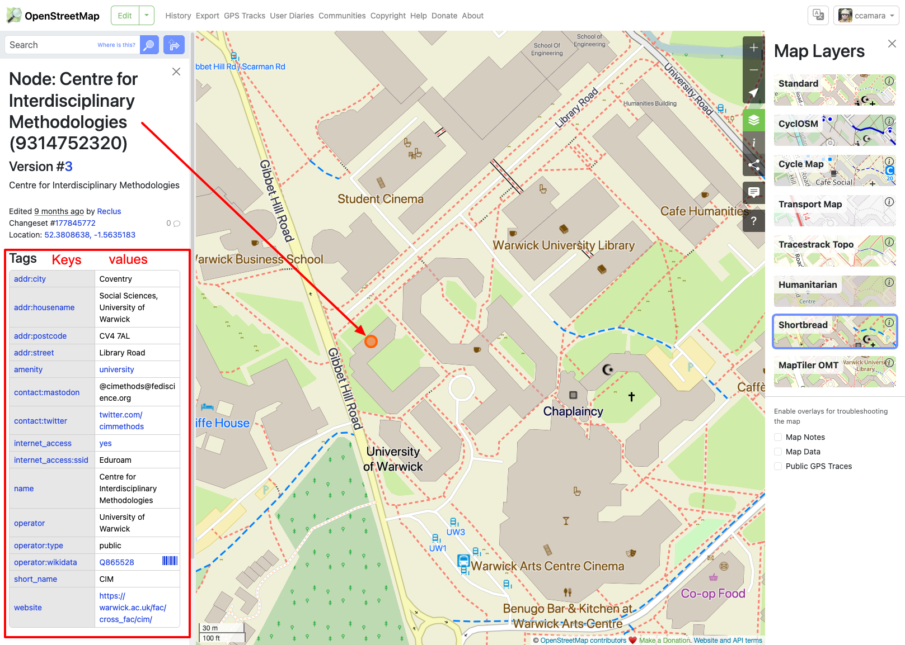
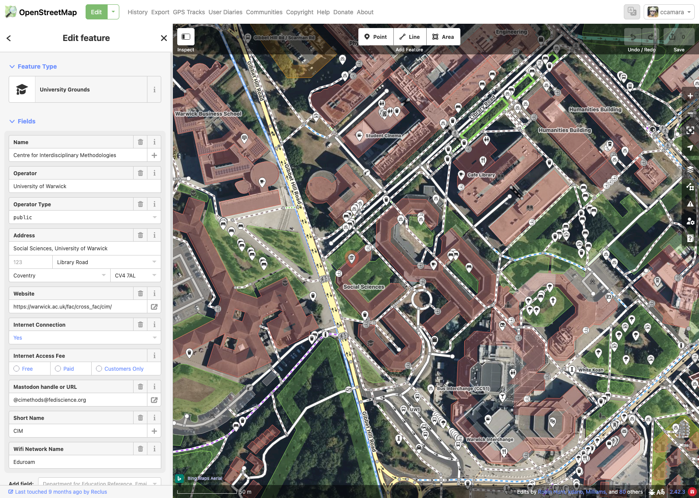
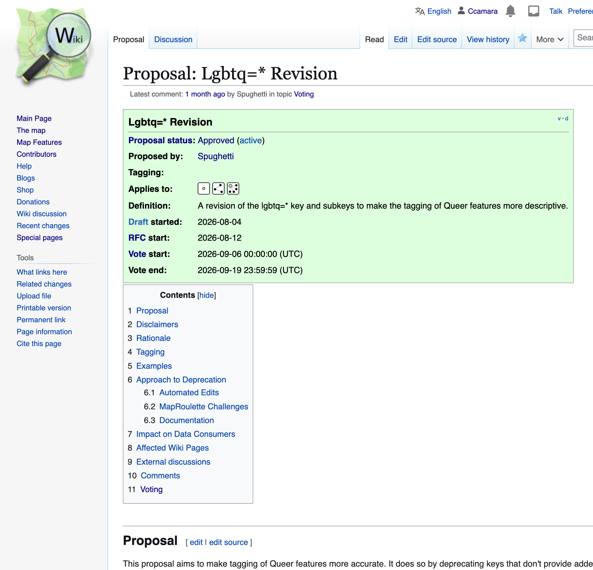
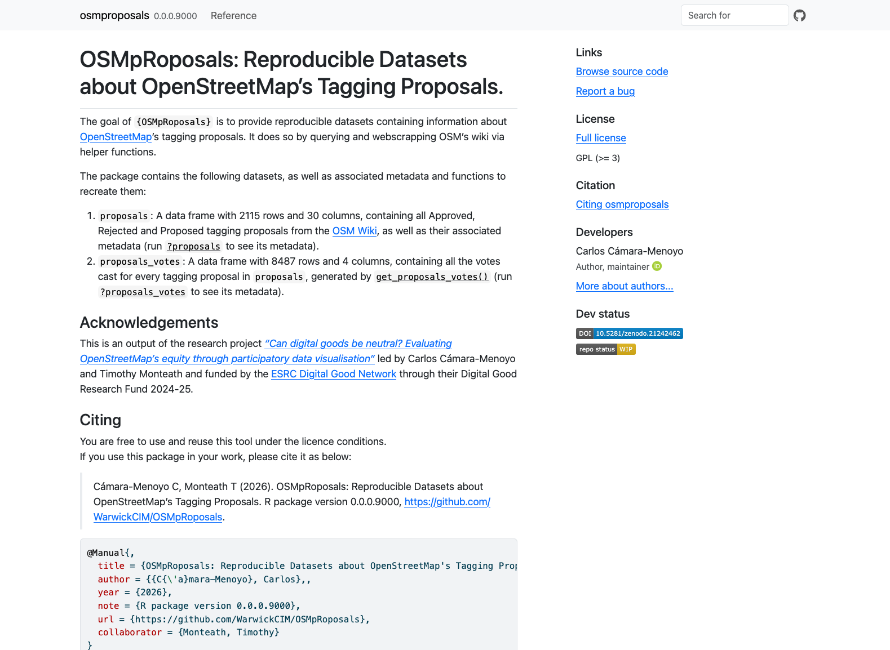

```{r setup}
# Load dependencies
library(dplyr)
library(knitr)

path_proposals <- "data/raw/proposals.csv"
path_votes <- "data/raw/proposals_votes.csv"

proposals <- read.csv(path_proposals) 
proposals_votes <- read.csv(path_votes)
```

# Labs overview

We will be replicating an ongoing research project that uses a data-centric approach to interrogate about considerations of data production and EDI.

**Learning outcomes:**

- Gain technical skills to work with and interrogate datasets to address real research questions

- Gain critical skills to interrogate and work with dataset

- Familiarise with data-centric research projects

# About the research {.smaller background-color="#BBDF46" background-image="media/esrc_digital_good_network.png" background-position="95% 5%" background-size="127px 128px"}

::: r-fit-text
Can Digital Goods Be Neutral?
:::

::: r-fit-text
Evaluating OpenStreetMap’s equity through participatory data visualisation
:::

The foundations of this work reside on the collaborative work made with an **amazing team**:

:::::: columns
::: {.column width="30%"}
UNIVERSITY OF WARWICK

- Dr. Carlos Cámara-Menoyo (PI)

- Dr. Timothy Monteath (Co-I)

- Hazel Cyril, Lilly Makkos (RAs)
:::

::: {.column width="30%"}
GEOCHICAS

- Dr. Selene Yang

- Silvia Rivera Alfaro

- Alejandra Canclini
:::

::: {.column width="30%"}
ADVISORY GROUP

- Dr. Jorge León (Universidad de Zaragoza)

- Dr. Rachel Palmen (Universitat Oberta de Catalunya)
:::
::::::

This project was **funded by the ESRC Digital Good Network**, through their Research Fund 2024-25.

## The problem {background-image="media/960px-Nova_totius_Terrarum_Orbis_geographica_ac_hydrographica_tabula_(Hendrik_Hondius)_balanced.jpg" background-opacity="0.4" background-color="black"}

- Historically, **Maps and power have gone hand in hand**.[@crampton2009; @harley2008; @wood1992]

  - Maps are never neutral: they have a political agenda [@haraway1988; @harley1989; @monmonier2018]
  - Historically used for domination, control and/or surveillance [@foucault1995; @scott2020; @graham2005; @edney1999]

::: fragment
- Critical and Feminist Geography have **critiqued map’s objectivity**:

  - Flagging (unconscious) bias by map-makers (usually men) [@monk1982]

  - Challenging positivist approaches and based exclusively in quantification [@pickles1995]

  - Highlighting importance on what is being presented and silenced [@pavlovskaya2009; @kwan2002; @dignazio2020]
:::

## Object of study {background-image="media/osm.png" background-opacity="0.6" background-color="black"}

::: r-fit-text
OpenStreetMap: more than a map
:::

OSM is the biggest and most precise free/libre spatial database of the world

- It's a **Geospatial Database**
  - 9.1 billion nodes (2024-03-31) \| Data under Open Database License (ODbL)
  - Flexible data structure based on `key = value` pairs
- It is also **a map** (or a series of maps)
  - that have an opinionated representation of the database
- It is a **global and huge community** (of 10,000,000 users worldwide!):
  - Anyone can contribute to it:
  - Adding / Editing map
  - Deciding what is included and how is represented

## Two notes on OSM data

**Size:** OSM data is large! **167 GB** (compressed). To reduce size:

- Split by region, time


------------------------------------------------------------------------

**Structure:** `key(s) = value(s)`



---



## The questions {.center background-color="#BBDF46"}

Some questions we were asking ourselves were:

1.  Who is contributing to OSM?
2.  How are they contributing?
3.  How equitable and inclusive is OSM's data?

# Today's plan {background-color="#A499F4"}

You will be working with your laptops with a real **dataset** about OSM's tagging proposals.to:

1.  Explore it
2.  Interrogate it
3.  Manipulate it

In order to address similar questions about EDI in the data production process.

::: notes
But this is what we did. This is what you're going to do:
:::

## Session's goals

1.  Familiarise with the dataset (and the process it represents)
2.  learn tidyverse's syntax for frequent data manipulations:
    1.  `filter()` to subset rows matching some conditions
    2.  `select()`, to subset columns (by name or position)
    3.  `group()` and `summarise()` to compute summaries based on some criteria
    4.  `join_by()` to combine datasets
3.  learn when to apply these methods to address research questions

# Data

## Tagging proposals {.smaller}

::::: columns
::: {.column width="30%"}
Anyone can suggest what to tag and/or how to tag it. Process [documented here](https://wiki.openstreetmap.org/wiki/Proposal_process).

1.  Create a wiki page describing the proposal and its rationale
2.  Request for Comments
3.  Address every comment
4.  Voting
    1.  Min 8 votes
    2.  Min 3 positive votes per 1 negative vote
:::

::: {.column width="70%"}

:::
:::::

## Datasets {.smaller}

:::::: columns
::: {.column width="50%"}
**Via [{OSMpRoposals}](https://warwickcim.github.io/osmproposals/) R-package: Provides two reproducible, citable, documented and ready to use (offline) datasets**:

1.  `proposals`: a dataframe of every tagging proposal, consisting of `r format(nrow(proposals), big.mark=",")` rows and `r ncol(proposals)` columns.
2.  `votes`: a dataframe of every vote cast, consisting of `r format(nrow(proposals_votes), big.mark=",")`\` rows and `r ncol(proposals_votes)` columns.

**Methods: Data Gathering and cleaning:**

1.  Data Gathering: API Query (MediaWiki) +

    Web scrapping

2.  Data cleaning: filtering right types of content, values extraction, formatting...

**Documentation**

1.  Datasets' metadata
2.  Functions
3.  Usage and download (WIP)
4.  DOI and how to cite
:::

:::: {.column width="50%"}



::::
::::::

## Questions

We will be interrogating our data to answer these groups of questions:

1.  How diverse is this dataset?
2.  How much labour is involved in creating a tagging proposal?


# References
