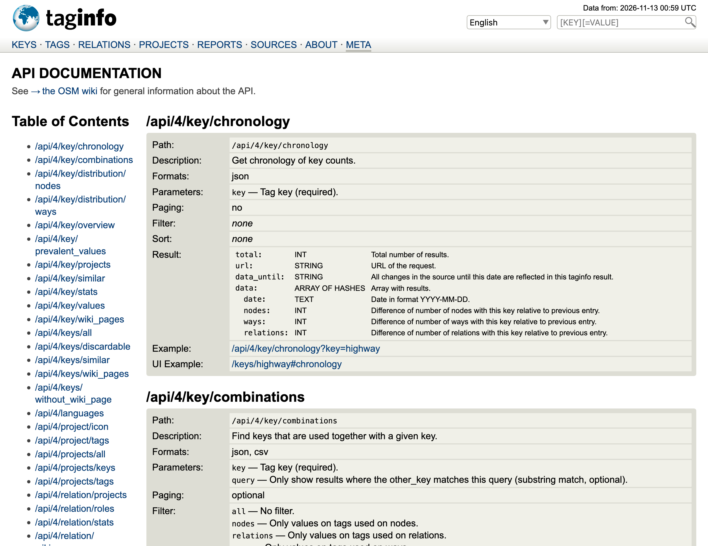

In this session, we will be be using 3rd party APIs to retrieve data and expand our dataset. We will be using two services that have public APIs and will be using them via web browser and code.

## Slides

```{=html}
<iframe class="slide-deck" src="/content/week_7/slides.html" title="Slides: Maps, world-views and neutrality"></iframe>
```

[Open the slides in full screen](/content/week_7/slides.html)

## Taginfo

From OSM Wiki:

> **Taginfo** is a system for finding and aggregating information about OSM tags and making it browsable and searchable. It was created by [Jochen Topf](https://wiki.openstreetmap.org/wiki/User:Joto "User:Joto").
>
> You can try it out at: [**taginfo.openstreetmap.org**](https://taginfo.openstreetmap.org/). This is the main taginfo site and covers the whole

**Why is this useful?**

OpenStreetMap uses a system of [^1] (combinations of keys and values) to describe geographic objects. Anyone can create new tags and add them to existing or new objects, making the map very flexible but also potentially confusing.

[^1]: Refer to <https://wiki.openstreetmap.org/wiki/Tags> for more information about what tags are and how they work.

**How can this help?**

Taginfo provides data to adress questions such as:

1.  How popular is a tag? How has this changed over time?
2.  Where is it used?
3.  What does it mean? How to use it?
    1.  Points, areas...
    2.  Is it used along other keys
    3.  Which are the possible values allowed?

### GUI

Accessing [**taginfo.openstreetmap.org**](https://taginfo.openstreetmap.org/).

{#fig-taginfo-overview}

::: callout-caution
#### Task

1.  Pick a key (or a tag) of your interest
2.  Use the GUI to explore what it says about the them.
3.  Can you answer any of the aforementioned questions about the tag?
:::

### API

Taginfo offers several endpoints. Each endpoint (and the parameters is accepting and the outputs) is documented here: <https://taginfo.openstreetmap.org/taginfo/apidoc>. As seen in @fig-taginfo-api-documentation, there are multiple endpoints. Each of them is thoroughly described.

{#fig-taginfo-api-documentation}

::: callout-important
#### How to read this?

Taginfo's API documentation may seem daunting, but it provides key information that is important to understand:

- `path`: is the url of the endpoint that we need to query
- `description`: provides an explanation of what the endpoint does
- `format`: explains the format in which the results are returned. In this case is a `json` file, which does not store information in rows and columns, and will need to be converted to a data frame.
- `paging`: in this case is set to `no`, which means that all the results will be displayed in a single page/file.
- `sort`: there's no sorting
- `result`: this lists every field contanined in the resulting json file, along with an explanation of their type and a description.
- `example`: this provides a URL with a query. This is useful in two ways: 1) we can see the URL patterns, 2) we can see how a result would look like.
- `UI example`: the equivalent query, as seen through the GUI (Website).
:::

#### Quering Taginfo API with R

We will be using two packages: 1. `{jsonlite}`: to work with data stored in a json file. 2. `{dplyr}`: to manipulate a dataframe.

```{r}
#| warning: false

library(dplyr)
library(jsonlite)

selected_key <- "wheelchair"

# Set up the API endpoints URL
endpoint_chronology <- paste0(
    "https://taginfo.openstreetmap.org/api/4/key/chronology?key=", 
    selected_key
)

# Send a GET request to the API endpoint
response <- fromJSON(endpoint_chronology, simplifyDataFrame = TRUE)

# Save the data in the response (json) into a dataframe
key_chronology <- as.data.frame(response$data)

# We want to store the name of the key
key_chronology <- key_chronology |> 
  mutate(
    key = selected_key,
    date = as.Date(date)
  ) |> 
  relocate(key, .before = 1)


head(key_chronology)

```

We can even create some (basic) visualisations with that data:

```{r}
# Plot cumulative way usage with base R:
plot(x = key_chronology$date,
     y = cumsum(key_chronology$ways),
     type = "l",
     lwd = 2, 
     col = "red", 
     main  = paste0("Cumulative '", selected_key, "' key usage on ways"),
     xlab  = "Date", ylab = "Ways (cumulative)"
)
```

::: {.callout-caution collapse="true"}
### Your turn: Can you adapt the code to retrieve data from the [prevalent values endpoint](https://taginfo.openstreetmap.org/taginfo/apidoc#api_4_key_prevalent_values)?

One option could be the following code:

```{r}
selected_key <- "wheelchair"

# Set up the API endpoints URL
endpoint_prevalent_values <- paste0(
    "https://taginfo.openstreetmap.org/api/4/key/prevalent_values?key=", 
    selected_key
)


# Retrieve key overview
response <- fromJSON(endpoint_prevalent_values, simplifyDataFrame = TRUE)
key_prevalent_values <- as.data.frame(response$data)

head(key_prevalent_values)

```
:::

## Overpass

Overpass is a read only API that retrieves **map features** containing a certain `key` or `tag`. It offers a way to query the map to look for specific features.

You can read more about it in the wiki: <https://wiki.openstreetmap.org/wiki/Overpass_API>

### GUI

Probably, the most popular way to intertact with overpass is through the web interface <https://overpass-turbo.eu>

{#fig-overpass-turbo}

How to use it?

Overpass-turbo has a great documemntation in the "help" button, but a possible outline for basic usage could be:

1.  Select the region you want to query the features, either by:
    1.  Navigating the map until the desired area
    2.  Typing the name of the location in the search box within the map
2.  Use the wizard to build your query and providing keys (and optionally, values)

::: callout-tip
### Queries

The Wizard builds Overpass queries from a short search expression. It understands the following conditions: Tag conditions

- `key=value` — objects tagged key=value
- `key!=value` — objects not tagged key=value
- `key=*` — objects that have the tag key, with any value
- `key!=*` — objects that do not have the tag key
- `key~value` — objects whose key value matches a regular expression (append /i to ignore case)
- `~key~value` — objects where both the key and the value match a regular expression
- `key!~value` — objects whose key value does not match a regular expression
- `key:value` — objects whose key value contains value
- `value` — a plain search term is looked up among the known presets, e.g. “Drinking Water”
:::

3.  Run the query by either:
    1.  Clicking on "Build and run the query" (on the wizard)
    2.  Clicking on "Run" (main screen)
4.  (optionallly) Export the results

### API

Overpass API's documentation is spread across multiple pages at OSM wiki: <https://wiki.openstreetmap.org/wiki/Overpass_API>.

#### Quering Overpass  API with R

In this case, due to its relatively complexity, we will be using a specialised package to use Overpass API: [`{osmdata}`](https://docs.ropensci.org/osmdata/).

::: callout-tip
#### How to get a bounding box coordinates

Overpass needs a bounding box (usually shortened to bbox) is a rectangular area defined by two longitudes and two latitudes, where: - Latitude is a decimal number between -90.0 and 90.0. - Longitude is a decimal number between -180.0 and 180.0.

They usually follow the standard format of:

- bbox = left,bottom,right,top
- bbox = min Longitude , min Latitude , max Longitude , max Latitude

There are a number of websites to obtain the actual values for a given region, such as <https://norbertrenner.de/osm/bbox.html>
:::

```{r}
#| label: osmdata
#| cache: true
# Uncomment below if you don't have osmdata installed in your system:
# install.packages("osmdata")

library(osmdata)

# Getting our bounding box

warwick_bbox <- getbb("University of Warwick")
#warwick_bbox <- c(-1.57418,52.37887,-1.55783,52.38314) #Obtained from https://norbertrenner.de/osm/bbox.html

warwick_art <- opq(bbox = warwick_bbox) |> 
    add_osm_feature(key = "tourism", value = "artwork") |>
    osmdata_sf()

# Explore the data
warwick_art

```

::: aside
`sf` stands for [Simple Features](https://r-spatial.github.io/sf/), and is a data type used to store geospatial information. Geospatial features can be: - points - lines - polygons (i.e., closed shapes) - multilines (a group of lines, not necessarily adjacent) - multipolygons (a group of polygons, not necessarily adjacent)

Refer to <https://r-spatial.github.io/sf/> for more information.
:::

::: callout-important
#### Understanding osmdata objects

The `warwick_art` returned by our query is a list that contains multiple nested objects:

- `$bbox`: the bounding box containing the features
- `$overpass_call`: the call made to overpass api, using overpass syntax
- `$meta`: medatada
- `$osm_points`: a `sf` object containing points
- `$osm_lines`: a `sf` object containing lines
- `$osm_polygons`: a `sf` object containing polygons
- `$osm_multilines`: a `sf` object containing multilines
- `$osm_multipolygons`: a `sf` object containing multipolygons

For more information, refer to <https://docs.ropensci.org/osmdata/articles/osmdata.html#the-osmdata-object>
:::

#### Creating a map

Let's explore the actual data from overpass:

```{r}
#| label: osmdata-head
head(warwick_art$osm_points)
```

As we can see, this object contains both, geometry, and attributes describing the feature

::: {.callout-caution collapse="true"}
### Can you recognise any of those attributes?

Indeed! Each of the column names are different keys from OpenStreetMap!
:::

```{r}
#| label: leaflet-map
# Uncomment below if you don't have osmdata installed in your system:
# install.packages("leaflet")

library(leaflet)

# Save into a separate object to reduce typing.
points <- warwick_art$osm_points

# Create the interactive map
leaflet() |> 
  addTiles() |> 
  addMarkers(data = points)

```

We can do slightly better by adding some popups displaying the attributes:

```{r}
#| label: leaflet-map-popup

# We create a new column aggregating multiple fields to be displayed in the popup
points <- points |> 
  mutate(
    popup = paste(
      sep = "<br>",
      name,
      artist_name,
      artwork_type
    )
  )

# Now, repeat the map, but adding labels and a popup
leaflet() |> 
  addTiles() |> 
  addMarkers(
    data = points,
    label = ~name,
    popup = ~popup
  )


```

## Wrap up

In this session we've learnt a number of different things!

1.  We got a theoretical understanding on strategies to work with big data.
    1.  And how API's are examples of outscaling our infrastructure
2.  Through interacting with two different API services we learnt:
    1.  We gained an understanding on how to get started with API services (e.g. documentation) and what to expect from them
    2.  We learnt how to interact via GUI and through code
3.  When interacting with API through code, we learnt:
    1.  To use generic functions to query the APIs directly
    2.  To use specialised libraries to work with specific APIs

And we have also refreshed concepts from previous week:

1.  Manipulating data using `dplyr`.
