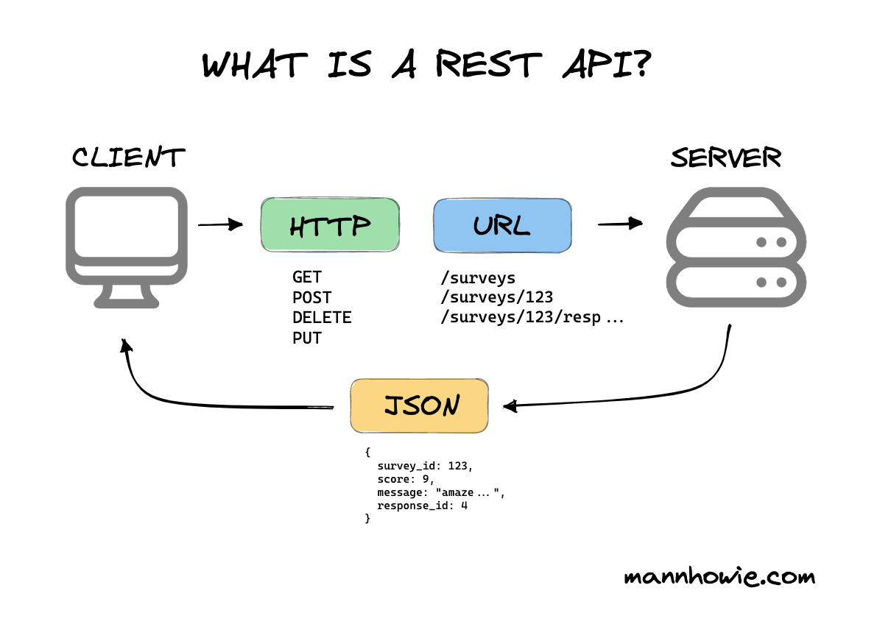
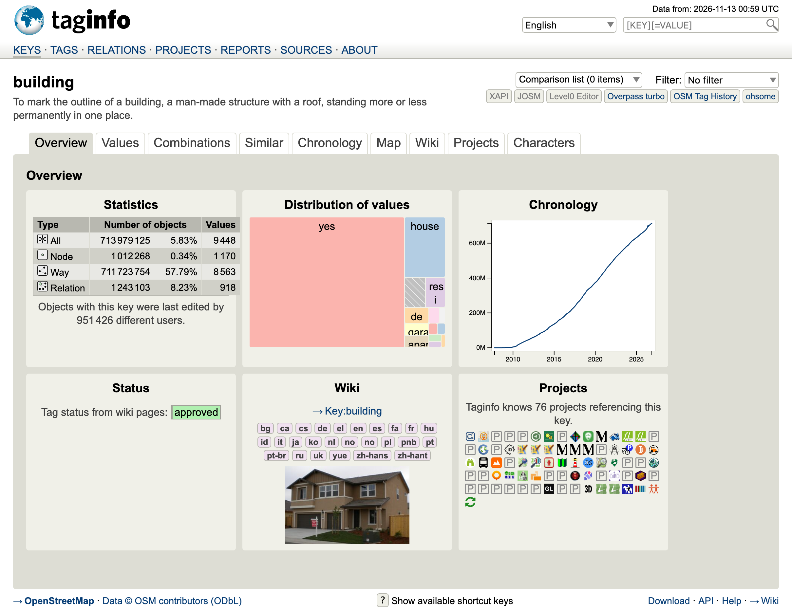
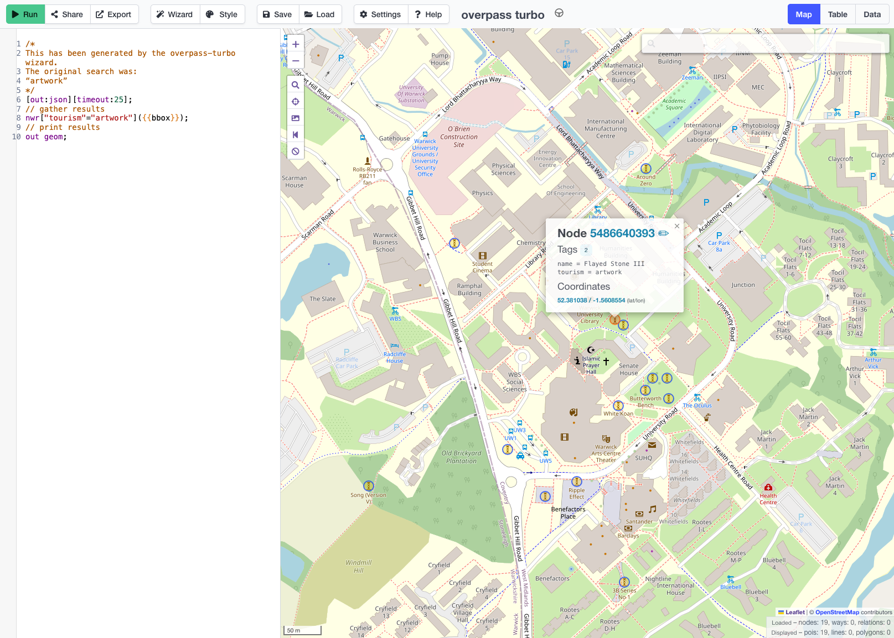

Last week:

- We worked with relatively big datasets

- We used R to interrogate the data and answer some research questions

------------------------------------------------------------------------

We didn't have time to discuss if those datasets were big data or not

According to Ulrich Matter [-@matter2024, Chapter 1], big data is either:

- Data that is **difficult to handle**:

  - because it has been “gathered from unorthodox sources, providing poorly structured data (e.g., raw text, web pages, images, etc.)

  - because of the infrastructure needed to store and load/process large amounts of data

- Data that is hard to get value from due to **size and complexity**.

# What happens when our data is too big to fit in our machine?

::: notes
It may be tempting to answer: get a better machine. Increase RAM or SSD/HDD, but this is only one option, and possibly a last resource option.
:::

# Some strategies for dealing with big data

Before getting a better machine, there are other things we may want to consider

::: centered
Simplify -\> Otpimize -\> Outscale -\> Upscale
:::

## 1. Simplify

*The focus is on the methods (The Data Scientist Approach)*

**Simplify our data** so we can operate using traditional statistical analysis while **preserving same statistical validity**.

Examples:

1.  Can we simply get a random sample of the data?
2.  Can we reduce the number of variables (e.g. use principal components)?

If not, go to next options

## 2. Optimize

*The focus is on the software (The RSE approach)*

1.  Optimize code
    1.  use more efficient packages (e.g. `{dplyr}` or `{data table}`)
    2.  parallel processing
    3.  use more efficient programming languages
2.  Optimize file formats:
    1.  Column Stores (): good for analytics over large data (OLAP) (e.g. "Average revenue by region, last 12 months")
        1.  [Parquet](https://parquet.apache.org/) (`.parquet`)
        2.  [DuckDB](https://duckdb.org/) (`.duckdb`)
    2.  Row Stores: goof for many small reads/writes (e.g. "Fetch order #48291 by ID")
        1.  [SQLite](https://sqlite.org/index.html) (`.sqlite`)

## 3. Outscaling

*The focus in on the hardware (The sysadmin, cloud engineer, HPC, data scientist... approach)*

::::: columns
::: {.column width="50%"}
Using somebody else's resources (usually better than ours or optimized for the task):

1.  APIs
2.  Cloud computing
3.  Servers
4.  High Performance Computer Cluster (HPC)
:::

::: {.column width="50%"}
](https://warwick.ac.uk/research/rtp/sc/sulis/edit-contents/211015_1311_hollis_tif_30020558276.jpg?maxWidth=&maxHeight=){alt="Warwick's Sullis HPC" fig-align="right"}
:::
:::::

## 4. Upscaling

*The focus is on the hardware (The sysadmin approach)*

:::::: columns
:::: {.column width="40%"}
Improving our hardware specs.

::: {.callout-warning appearance="minimal"}
Considering the increasing hardware costs, this should be the last resource after having tried some of the previous options.
:::
::::

::: {.column width="60%"}
](media/Average_price_of_DDR5-5200_2x16_GB_RAM_kits.png)
:::
::::::

# That's not all

1.  None of those methods are exclusive: sometimes we will need to combine two or more of those approaches.
2.  There are more approaches, refer to [@gold2019] or [@matter2024, Chapter 2]

# Outscaling using APIs

## APIs 

**Application Programming Interface (API)**: It is a **type of software interface**, that enables two computers/apps (a client and a server) to communicate and interact with each other through a set of given options and conditions that are documented and stable.

::::: columns
::: {.column width="50%"}

:::

::: {.column width="50%"}

:::
:::::

# Using OSM's APIs

As we know, OSM is (also) an ecosystem of tools. There are many API services available, some maintained as 3rd party services. We are going to see two of them

## Taginfo

Aggregates and visualises information about all the tags used at OSM:

## Overpass

# References
